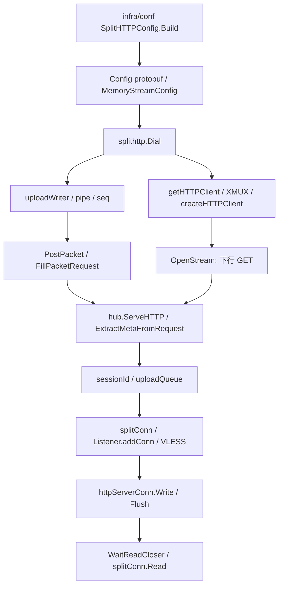

# RayBox-rx：Xray-RX 阶段 0 审计与阶段 1 设计

本文保留2026-10-29历史研究口径；不代表当前源码只有阶段1能力。原始研究快照及私有产物不随本仓库发布。

本项目是实验补丁。指定俄罗斯机经固定 CF 入口 `104.17.1.1:2083` 的普通 XHTTP 已完整下载 1GiB，28.095 秒、36.447 MiB/s，字节数与 SHA-256 一致；未启用 RX，使用 x25519、自有 SNI/Host 和正常 TLS 验证。受限入口 `104.21.44.55` 上的 RX 1GiB 仍失败，不能把入口差异推广为全部网段或所有运营商规则。以下保留最初阶段 0/1 设计，追加上行重试、旧端安全修复、有限响应诊断及完整证据见 [现场报告](xray-rx-field-20261029.md)。审计日期：2026-10-29。源码基线：官方 Xray-core v26.10.29，`0afec66085a85191e9dd2a4a6646c7c9a94688d1`。组合仓库中的源码位于 `Xray-core/`。工具链为校验官方 SHA-256 后解压的 Go 1.27.3 windows/amd64（仅工作目录使用）。上游原始 `splithttp` 和 `infra/conf` 测试均通过。

## 14 项参考资料

| # | 来源 | 技术结论与本项目适用性 |
|---|---|---|
| 1 | [官方源码](https://github.com/XTLS/Xray-core/tree/0afec66085a85191e9dd2a4a6646c7c9a94688d1) | XHTTP 实现在 `transport/internet/splithttp`；GET/header 上行、上下行分离、H1/H2/H3、XMUX 均已有实现，不重复开发。当前下行 GET 生命周期就是代理连接生命周期。 |
| 2 | [XHTTP 设计 #4113](https://github.com/XTLS/Xray-core/discussions/4113) | packet-up 上行通过 session ID 和 seq 重组，下行为长 GET；stream-up 与 stream-one 为不同模式。XMUX 管理 HTTP 客户端复用，而非保证每个 HTTP 请求使用独立 TCP。文中 CDN 空闲切断与连接级配额是不同故障。 |
| 3 | [PacketDown 请求 #4846](https://github.com/XTLS/Xray-core/issues/4846) | 原始问题明确指每条 TCP 约 15–20KB 后静默冻结，并非 HTTP Body 上限；不同请求仍复用 TCP 无效。作者已指出数千次握手的成本。后续空闲超时讨论不能覆盖或改写原始需求。 |
| 4 | [Downlink Resume #6755](https://github.com/XTLS/Xray-core/pull/6755) | 已关闭、未合并。偏移字段可放 query/cookie/header，响应头回显；作者报告某 CDN 自行处理 Range，不能外推所有 CDN。活动 writer 下缓存满会丢未确认旧数据，纯下载无独立 ACK，Attach 回放与新 Write 有交错窗口；偏移回显不符只告警，可能先交付错误位置的数据。重开仍复用原 HTTP 客户端，未保证新 TCP；无独立静默冻结检测。缓存/并发测试不足以证明端到端无损。维护者关闭时称复杂度过高，后续另指出延迟、ACK 与未覆盖 #4846，不能照搬其稳定性结论。 |
| 5 | [PacketDown + KeepAlive #7159](https://github.com/XTLS/Xray-core/pull/7159) | 已关闭、未合并。data/padding 帧、长度、可选 session 节选与 seq；只处理下行空闲保活，GET 死亡依旧结束代理连接。没有多路径排序、ACK 或重传；只剥掉响应确认头可能使两端对帧格式认知不一致，旧端 fallback 测试未覆盖该情况。作者列出的手工端到端测试只有 H1，不能据此声称 H2/H3 实测。维护者称暂不计划为这种打断引入帧，阶段 1 不引入 PacketDown。 |
| 6 | [上下行分离 #5377](https://github.com/XTLS/Xray-core/discussions/5377) | downloadSettings 配合 IP/协议/回落实现分离，但必须最终关联到同一会话状态。可作备用方案，不代表廉价 CDN 承载下载的目标已实现；本原型暂不组合 downloadSettings。 |
| 7 | [zapret2 stallbreak #327](https://github.com/bol-van/zapret2/discussions/327) | 在 TLS 记录中途停住、或客户端请求无响应时用定时器判断并发 RST，促使应用重试。作者单一莫斯科运营商小样本 15/30→28/30，网关 19/20；边界处冻结可能无法区别空闲。Xray HTTP 层不能直接套用 TLS 边界法；本原型通过服务端 produced offset 辅助确认待下载数据。 |
| 8 | [俄罗斯分析 #490](https://github.com/net4people/bbs/issues/490) | 报告 TCP/UDP、TLS 1.2/1.3、SNI/CIDR 白名单及按双向包数冻结的不同观察。约 25 包的后续描述是环境观察，不能硬编码为通用规则。阶段 2 必须做连接级故障，区分字节阈值与真实 IP 包计数。 |
| 9 | [Cloudflare 官方说明](https://blog.cloudflare.com/russian-internet-users-are-unable-to-access-the-open-internet/) | 2025-06-26 说明自 6 月 9 日起多个俄 ISP 的限制，表现含首 16KB、注入终止包、丢包超时，涉及 H1/H2/H3；明确发生在当地 ISP。不能解读为 CF 的请求体限制，也不能据此承诺换 QUIC 即可解决。 |
| 10 | [Habr 评论](https://habr.com/ru/articles/1008164/comments/) | 多地反馈运营商、固定/移动网、时段、目的网段表现不同；有人报告按包数、新连接恢复，也有相互冲突的归因。作为测试矩阵线索，不能视为统一测量数据或精确阈值。 |
| 11 | [NTC 原链接](https://ntc.rkn.quest/t/16%D0%BA%D0%B1-%D0%B1%D0%BB%D0%BE%D0%BA%D0%B8%D1%80%D0%BE%D0%B2%D0%BA%D0%B0/22516) / [同主题可用域名](https://ntc.party/t/22516) | 已经备用官方论坛域名取到同一 topic ID 的全部 223 条可见帖子。首帖及 #3 报告约 14–25KB、部分明文 HTTP 约 24–32KB；#129 承认曾把 CF 多请求限流误判为封锁；#130–133 同 ISP 邻近住宅也可表现不同；#170 报告 SNI 与目的 IP 组合相关。不能以固定 16KB、单 SNI 或单次 HTTP 200 统一判断。 |
| 12 | [CensorLess PETS 2026](https://gfw.report/publications/pets26b/en/) | 本地代理、serverless bridge refresher、live migration 把连接状态与易变入口分离，值得借鉴。论文在南京阿里云 AS45090 测试，非俄罗斯住宅网；97.1% 成本比较基于每代理每月 6.76GB、约 0.00296MB/请求和相应 Lambda 计费假设，不能移植为持续大流量 VPN 的成本结论。 |
| 13 | [QUIC SNI 研究 #654](https://github.com/net4people/bbs/issues/654) | 研究总结俄罗斯不晚于 2023-07 已部署 QUIC SNI 过滤，解析公开可导出密钥的 Initial，观察到四元组残留封锁及协议版本差异；不是“QUIC 加密即可隐藏 SNI”。仅作环境依据，本版不开发 QUIC 绕过。 |
| 14 | [CF 网段差异 #662](https://github.com/net4people/bbs/issues/662) | 2026-08-28 三轮数据中心探针曾将莫斯科 AS14576 的差异归因于 CF 前缀；作者在 [2026-09-02 回复](https://github.com/net4people/bbs/issues/662#issuecomment-5514550512) 承认不同解析器返回不同网段，原来的域名与前缀对应关系及 namecheap 对照不足以成立该归因。评论者关于 SNI、TLS 指纹的说法仍属单线路观察与猜测。后续测量必须固定并记录解析器、实际边缘 IP、SNI、协议、时间和完整响应体，不以单次 HTTP 200 或正文标题判定可用性。 |

证据快照（正文、JSON、补丁）保存在工作区 `artifacts/research`，不含用户凭据。#6755 和 #7159 的 fork LICENSE 均核对为 MPL-2.0，与上游一致。本阶段独立实现，未 cherry-pick 旧 PR。发行可执行文件时，应使接收者能合理、及时取得精确基线及全部对应修改组成的受保护源码，并保留适用声明；仅提供差异补丁和 LICENSE 不必然足够。现有发布包另含完整对应源码 ZIP，见 `xray-rx-usage.md`。旧 PR 的作者报告与本次静态代码判断不计入本项目已运行的验证结果。

关闭时间线：[Fangliding 于 2026-09-13 关闭 #6755](https://github.com/XTLS/Xray-core/pull/6755#issuecomment-5653685905)，称“这个重连复杂度太高了”；[RPRX 关于延迟、ACK 和 #4846 的评论](https://github.com/XTLS/Xray-core/pull/6755#issuecomment-5720463978) 在 9 月 17 日，不能写成关闭时的原话。#6755 正式 review 列表为空，相关意见来自普通评论。[#7159 于 2026-10-15 由 Fangliding 关闭](https://github.com/XTLS/Xray-core/pull/7159#issuecomment-6184640680)，称“暂时不计划为了这种打断引入帧机制”。两项均非作者自行关闭。

### NTC 全文补充核验

原 `ntc.rkn.quest` 的 HTML、JSON 和 RSS 都返回 525，`ntc.party/t/22516` 与 `ntc.party/t/22516.json` 返回 200。JSON 标题为 `16кб блокировка`，topic ID 为 22516；按 `post_stream.stream` 补取 `posts.json`，得到 223/223 条当前可见帖子，最大帖子编号 225（编号有缺口不等于抓取缺页）。原始 JSON、分页响应和 UTF-8 正文保存在 `artifacts/research/ntc-route-0.raw`、`ntc-posts-*.raw`、`ntc.txt`。

帖子属于社区观察而非受控实验。特别有价值的是自我纠错证据：[第 129 帖](https://ntc.party/t/22516/129) 作者在单次重测成功后，将之前失败归因于 CF 对多请求的限流；因此后续测试必须记录 HTTP 状态、是否握手成功、每条连接实际字节数和完整文件 hash，并控制请求频率。[第 130–133 帖](https://ntc.party/t/22516/130) 描述同一电脑和配置在同 ISP 的相邻用户处表现不同，讨论了路由差异；[第 170 帖](https://ntc.party/t/22516/170) 记录 IP–SNI 组合相关的个人观察，不能外推为所有运营商规则。论坛列出的工具与伪包策略仅作为资料阅读，本项目没有自动执行其扫描、流量注入或网络配置操作。

## 上游调用链

`config.go` 已把 payload 编码到 `data-0` 等头；`hub.go` 已解析。普通路径不更换此实现。`createHTTPClient` 为 H2/H3 建立可复用 transport；仅调用 OpenStream 不能保证新 TCP。原 hub 下行结束时删除 session、关闭 uploadQueue，必须在启用实验模式时将逻辑会话生命周期从 GET 分离。

## 阶段 1 最小方案及代码计划

1. 在 protobuf 与 JSON 配置增加 `rx` 实验配置，默认关闭；只允许显式 `packet-up`，暂拒绝 Browser Dialer、downloadSettings、H3 组合，避免无验证的自动降级。普通 XHTTP、REALITY、WebSocket 不变。
2. 新增 `rx_buffer.go`：固定上限环形缓存，字节 offset，单调 ACK，满时反压、不丢弃未确认数据；Close 标记最终 offset，过期/取消才销毁缓存。
3. 新增 `rx_server.go`：随机 bearer capability 绑定 session，GET 打开/恢复、HEAD ACK/探测，独立版本/offset 头并回显；offset、generation、身份、缓存窗口均验证。服务端控制会话数和 TTL，listener 关闭释放所有实验会话。恢复失效返回错误，不从零重放。
4. 新增 `rx_client.go`：串行 Read 精确累计交付 offset，每次重开创建专属 transport，不使用 XMUX 下行池；独立 HEAD ACK 支持纯下载。无数据且服务端无待交付字节视为正常空闲；有待交付且正在等 Read、超时后才触发 StallDetect。控制链路无响应是“不明故障”，有界重试，不声称已确认 TSPU。首次无能力协商时允许普通原始流；一旦确认后任何协商丢失均终止。
5. 小范围接入 `dialer.go`、`client.go`、`hub.go`，保持原 GET Header 编码。实验上行附带 capability，失败会中止同一逻辑连接；本版不恢复上行。
6. 单元测试 offset/ACK/上限/关闭；HTTP 集成测试旧端兼容、头剥离、跨会话拒绝、空闲不误判、故障后字节一致；运行上游相关包、配置测试、构建。提供独立命名产物与回滚说明。

## 成本和边界

50MiB / 16KiB = 3200 条有效数据连接（50MB 十进制约 3052 条），另有控制请求、TLS 握手、HTTP 头、重传；15–20KiB 阈值约 2560–3414 条。若每次冻住再等 3 秒恢复，单串行 50MiB 可额外耗时约 2.7 小时，吞吐远低于商业可用水平。本版验证正确性，不以并发遮盖成本。缓存上界约为 maxSessions × maxReplayBytes，之外仍有上传队列、Go 堆、HTTP/TLS 和内核缓存；DAU 不能直接推导并发容量。

阶段 2 才做完整真实 TCP 双向包数、RST/FIN/静默丢包、50MiB 并发、持续上传、长时间空闲、CPU/RSS 与恢复 p50/p95 测量。阶段 3 在这些验收后才研究 PacketDown、多路径重排和冗余竞速。可行性是“逻辑流能跨下行连接继续”，不是“所有运营商均可绕过”。
